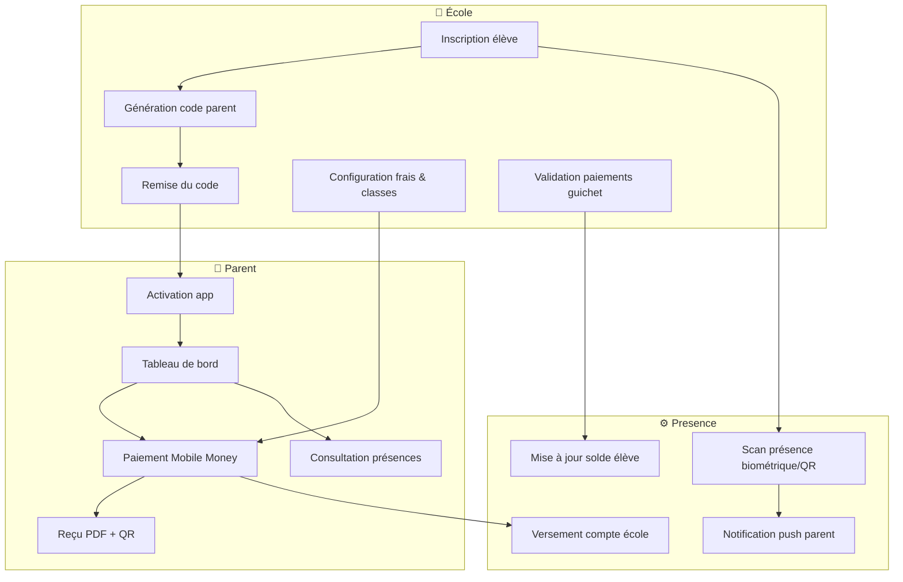

# Presence — Présentation pour les établissements scolaires

**Document marketing · Juillet 2026**  
**Public :** directions d’école, promoteurs, responsables financiers, parents d’élèves  
**Périmètre :** plateforme complète Presence (portail web + application mobile parent)

**Documents associés :**
- [MARKETING_FICHE_1PAGE.md](./MARKETING_FICHE_1PAGE.md) — fiche à remettre aux directeurs (1 page)
- [MARKETING_PRESENTATION.md](./MARKETING_PRESENTATION.md) — plan slide par slide (20–25 min)

---

## En une phrase

**Presence** est le système d’exploitation de votre école : présence en temps réel, encaissement des frais scolaires par Mobile Money et carte, communication instantanée avec les parents — le tout sécurisé, traçable et adapté au contexte congolais et centre-africain.

---

## Le défi que vous connaissez

| Problème quotidien | Conséquence |
|--------------------|-------------|
| Cahiers de présence papier | Erreurs, falsifications, perte de temps |
| Parents qui ne paient qu’en espèces au guichet | Files d’attente, retards de trésorerie |
| Aucune visibilité sur les impayés en temps réel | Relances manuelles, tensions |
| Parents non informés des absences | Inquiétude, méfiance envers l’école |
| Paiements sans reçu vérifiable | Contestations, fuites de recettes |
| Inscription chaotique en début d’année | Surcharge administrative |

**Presence** répond à ces six problèmes avec une seule plateforme connectée.

---

## Notre solution en trois piliers

```
┌─────────────────────────────────────────────────────────────────────┐
│                         VOTRE ÉCOLE                                  │
│                                                                      │
│   📋 Présence          💰 Finance           📱 Communication         │
│   biométrique / QR     Mobile Money         notifications            │
│   cahier numérique     guichet + en ligne   parents en temps réel    │
│                                                                      │
└──────────────────────────────┬──────────────────────────────────────┘
                               │
         ┌─────────────────────┼─────────────────────┐
         ▼                     ▼                     ▼
   Portail web            Application            API sécurisée
   PresenceCollab         mobile parent          multi-écoles
   (direction, finance)   (PresenceFintech)      (cloud)
```

### 1. Présence & sécurité des élèves

- **Pointage biométrique** (visage avec détection de vivacité) ou **QR code** à l’entrée de l’école ou en classe.
- **Cahier d’appel numérique** : saisie groupée par le professeur ou l’administration, scellé et exportable en PDF/CSV.
- **Tableau de bord en direct** : qui est présent, absent, en retard — mis à jour en temps réel.
- **Alertes fraude** : détection d’anomalies (VPN, GPS suspect, score de confiance faible).
- **Notification parent** : dès qu’un enfant est enregistré présent ou absent, le parent reçoit une alerte sur son téléphone.

### 2. Finance & recouvrement

- **Frais scolaires structurés** : scolarité mensuelle, inscription, activités — par niveau et par classe.
- **Paiement depuis le téléphone du parent** :
  - Orange Money
  - Airtel Money
  - M-Pesa
  - Carte bancaire (via Flutterwave)
  - Virement bancaire
- **Guichet espèces** : le caissier enregistre le paiement ; la direction valide — workflow adapté aux réalités locales.
- **Reçus sécurisés** : PDF avec QR code vérifiable publiquement — preuve incontestable pour l’école et le parent.
- **Relances automatiques** : rappels d’impayés programmés (fuseau horaire Kinshasa).
- **Moratoires** : possibilité d’accorder un délai de grâce à un élève, avec suspension des relances.
- **Versement direct sur le compte de l’école** : après validation KYC, les fonds Mobile Money et carte sont répartis vers le compte bancaire de l’établissement — le RIB n’est jamais exposé dans l’application parent.

### 3. Relation école–parents

- **Application mobile dédiée** (Android) : tableau de bord, historique de présence, paiements, reçus, notifications.
- **Codes d’activation simples** : pas d’inscription libre — l’école contrôle qui accède à la plateforme.
- **Pré-inscription en ligne** : les parents peuvent soumettre une demande ; l’administration valide ou refuse.
- **Notifications multicanal** : push mobile, SMS (Africa’s Talking), e-mail selon les préférences.
- **Passe numérique élève** : carte d’identité scolaire avec QR code sécurisé.

---

## Comment ça marche — du point de vue de l’école

### Étape 1 — Mise en service (1 à 3 jours)

| Qui | Action |
|-----|--------|
| **Opérateur Presence** | Crée votre école sur la plateforme, configure votre espace isolé (multi-tenant). |
| **Direction / promoteur** | Se connecte au portail **PresenceCollab** (web), configure les classes, les frais, le personnel. |
| **Responsable finance** | Renseigne le profil de règlement (RIB, banque, contacts) pour activer les paiements en ligne. |
| **Opérateur Presence** | Valide le KYC — les parents peuvent alors payer par Mobile Money et carte. |

> **Sans validation KYC**, le guichet espèces et les virements manuels restent disponibles. Les paiements en ligne sont activés après vérification du compte bancaire.

### Étape 2 — Inscription des élèves

1. L’administration inscrit l’élève (nom, classe, téléphone du parent, photo).
2. Le système génère automatiquement :
   - une **carte élève** avec QR code ;
   - un **compte parent pré-créé** (inactif) lié au numéro de téléphone renseigné ;
   - un **code d’activation à 8 caractères** (unique, à usage unique).
3. L’école remet le code au parent (SMS, papier, WhatsApp).

### Étape 3 — Activation du parent (premier enfant)

Le parent télécharge l’application **PresenceFintech** et :

1. Appuie sur **« J’ai un code — Activer mon accès »**.
2. Saisit son **numéro de téléphone** (format +243…), le **code école** et choisit un **mot de passe**.
3. Accède immédiatement au tableau de bord : enfants, soldes, présences.

> **Pas de formulaire d’inscription libre** : seuls les parents invités par l’école peuvent activer un compte. Cela évite les faux comptes et garantit que chaque parent est bien rattaché à un élève réel.

### Étape 4 — Enfants supplémentaires (2ᵉ, 3ᵉ…)

Si un parent a plusieurs enfants dans la même école ou ailleurs :

1. L’école génère un **nouveau code** pour chaque enfant supplémentaire.
2. Le parent **déjà connecté** utilise **« Ajouter un enfant »** et saisit le code — sans recréer de compte.

### Étape 5 — Vie quotidienne

| Moment | Ce qui se passe |
|--------|-----------------|
| **Matin — entrée** | L’élève passe au scanner biométrique ou QR → présence enregistrée → **notification push au parent**. |
| **Cours** | Le professeur peut compléter le cahier d’appel numérique depuis son interface. |
| **Paiement** | Le parent ouvre l’app → choisit les frais → paie par Mobile Money ou carte → reçu PDF instantané. |
| **Guichet** | Le caissier enregistre un paiement espèces → la direction valide → solde mis à jour. |
| **Soir** | La direction consulte le tableau de bord : présences du jour, encaissements, impayés, alertes. |

---

## Les outils à votre disposition

### Portail web PresenceCollab (direction & administration)

| Module | Ce que vous faites |
|--------|-------------------|
| **Tableau de bord** | KPIs : effectifs, présences, finances, alertes — actualisés en temps réel. |
| **Présences** | Flux live, heatmap, tendance hebdomadaire, cahiers numériques, mode kiosque QR. |
| **Élèves** | Fiche complète, historique, sanctions, verrouillage paiement si nécessaire. |
| **Inscriptions** | Pipeline d’inscription, approbation, génération de cartes élèves. |
| **Classes & professeurs** | Organisation pédagogique, détection de conflits d’emploi du temps. |
| **Invitations parents** | Génération et suivi des codes d’activation. |
| **Finance** | Paiements, factures, moratoires, lots scellés, audit, export. |
| **Vérifications** | File d’attente des paiements à confirmer (guichet, mobile). |
| **Fraude & sécurité** | Centre anti-fraude, alertes, journal d’audit. |
| **Notifications** | Envoi ciblé (par rôle, par classe), historique, relances. |
| **Personnel** | Invitation staff avec double vérification (e-mail + SMS). |

### Portail finance (caissier / comptable)

- **Caisse** : enregistrement rapide des paiements espèces.
- **Vérifications** : validation des paiements Mobile Money en attente.
- **Dettes & relances** : vue des impayés par élève et par classe.
- **Réconciliation** : rapprochement avec les flux bancaires et Mobile Money.

### Application mobile parent (PresenceFintech)

| Écran | Fonction |
|-------|----------|
| **Tableau de bord** | Vue d’ensemble : enfants, soldes, alertes, actions rapides. |
| **Présence** | Historique et taux de présence par enfant. |
| **Paiement** | Sélection des frais, checkout Mobile Money / carte, preuve de paiement. |
| **Historique** | Tous les paiements passés, filtrables par enfant, méthode, période. |
| **Reçus** | PDF téléchargeable + vérification QR publique. |
| **Notifications** | Alertes présence, paiements, messages de l’école. |
| **Pré-inscription** | Demande d’admission avec photo et informations médicales. |
| **Biométrie** | Enrôlement facial sécurisé (caméra live, anti-fraude). |
| **Passe numérique** | Carte d’identité scolaire sur le téléphone. |
| **Profil & sécurité** | Mot de passe, authentification à deux facteurs (MFA). |

---

## Sécurité & confiance — ce qui protège votre école

| Mesure | Bénéfice pour l’école |
|--------|----------------------|
| **Isolation par établissement** | Vos données ne sont jamais mélangées avec une autre école. |
| **Biométrie avec vivacité** | Impossible de tricher avec une photo imprimée — seul le visage réel est accepté. |
| **Moteur anti-fraude** | Analyse VPN, GPS, correspondance faciale, score de risque sur chaque opération sensible. |
| **KYC école** | Vérification du compte bancaire avant activation des paiements en ligne. |
| **Reçus signés (QR + HMAC)** | Chaque reçu est vérifiable — fini les faux justificatifs. |
| **Verrouillage après 5 échecs de connexion** | Protection contre les attaques par force brute. |
| **Double facteur (MFA)** | Sécurité renforcée pour le personnel (TOTP). |
| **Journal d’audit** | Trace de chaque action sensible (connexion, paiement, validation). |
| **Chiffrement des données** | Communications HTTPS, tokens JWT, stockage sécurisé. |

---

## Pourquoi Presence est fait pour la RDC et l’Afrique centrale

- **Mobile Money en priorité** : Orange Money, Airtel Money, M-Pesa — les moyens de paiement que vos parents utilisent déjà.
- **Guichet espèces conservé** : le digital ne remplace pas le cash — il le complète et le trace.
- **Numéros +243 normalisés** : validation automatique des numéros congolais.
- **SMS via Africa’s Talking** : codes OTP et alertes même sans smartphone haut de gamme.
- **Fuseau Africa/Kinshasa** : relances et réconciliations calées sur votre réalité horaire.
- **Français natif** : interface, notifications et reçus en français.
- **Fonctionnement dégradé** : saisie manuelle de présence si le réseau ou la biométrie est indisponible.
- **SaaS multi-écoles** : chaque établissement a son propre espace ; les paiements arrivent sur **votre** compte.

---

## Bénéfices mesurables pour votre établissement

| Indicateur | Avant Presence | Avec Presence |
|------------|----------------|---------------|
| Temps de saisie des présences | 15–30 min/classe/jour | Quelques secondes par scan |
| Délai d’information parent (absence) | Heures ou jours | **Instantané** (push) |
| Taux de recouvrement des frais | Variable, peu suivi | Suivi en temps réel + relances auto |
| Contestations de paiement | Fréquentes, sans preuve | Reçu QR vérifiable |
| Charge administrative inscription | Pics stressants | Pipeline numérique + pré-inscription |
| Visibilité direction sur la trésorerie | Rapports manuels | Dashboard live + exports |

---

## Parcours visuel simplifié



---

## Mise en service — calendrier type

| Jour | Action |
|------|--------|
| **J0** | Signature, création de l’école sur la plateforme |
| **J1** | Formation direction (2 h) : portail web, configuration initiale |
| **J2** | Import ou saisie des élèves, génération des codes parents |
| **J3** | Formation caissier / finance (1 h) : guichet, vérifications |
| **J4** | Déploiement scanners / QR, test avec un groupe pilote |
| **J5** | Communication aux parents : SMS + remise des codes |
| **J7** | Bilan semaine 1, ajustements |
| **J30** | Revue des KPIs : présences, encaissements, adoption parent |

---

## Questions fréquentes des directions d’école

**Faut-il que tous les parents aient un smartphone ?**  
Non. Les parents avec smartphone utilisent l’app ; les autres peuvent payer au guichet. Les notifications SMS restent disponibles.

**Nos données sont-elles en sécurité ?**  
Oui. Chaque école est isolée (multi-tenant). Les accès sont contrôlés par rôle. Un audit trail enregistre les actions sensibles.

**Que se passe-t-il si Internet est coupé ?**  
La saisie manuelle de présence et le guichet espèces fonctionnent ; la synchronisation reprend dès le retour du réseau.

**Comment l’école reçoit-elle l’argent des paiements Mobile Money ?**  
Après configuration et validation du profil bancaire (KYC), les fonds sont répartis automatiquement vers le compte de l’école via Flutterwave — sans que le parent voie le RIB.

**Un parent peut-il payer pour plusieurs enfants ?**  
Oui. Un seul compte parent, plusieurs enfants liés via des codes d’activation distincts.

**Peut-on empêcher un élève de payer si sa situation est bloquée ?**  
Oui. L’administration peut verrouiller les paiements d’un élève (sanction, dossier incomplet).

**L’école peut-elle refuser une pré-inscription ?**  
Oui. Les demandes arrivent dans un file d’attente ; l’admin approuve ou rejette.

---

## Offre & accompagnement

| Composant | Inclus |
|-----------|--------|
| Portail web PresenceCollab | Tableau de bord, présences, élèves, finance, notifications |
| Application mobile parent | Android (iOS selon déploiement) |
| Hébergement cloud sécurisé | Infrastructure managée, sauvegardes |
| Support technique | Assistance à la mise en service |
| Mises à jour | Évolutions fonctionnelles et correctives |
| Formation initiale | Direction + finance + option professeurs |

> *Les modalités commerciales (tarification, SLA, nombre d’élèves) sont définies dans votre contrat de partenariat.*

---

## Glossaire — termes simples

| Terme | Signification |
|-------|---------------|
| **Code d’activation** | Code à 8 caractères remis au parent pour activer son compte (1 code = 1 élève). |
| **KYC** | Vérification d’identité bancaire de l’école avant activation des paiements en ligne. |
| **Mobile Money** | Paiement depuis le solde téléphonique (Orange, Airtel, M-Pesa). |
| **Moratoire** | Délai de grâce accordé à un élève pour payer sans relance. |
| **Multi-tenant** | Chaque école a son espace séparé sur la même plateforme. |
| **QR code élève** | Code scannable pour enregistrer la présence à l’entrée. |
| **Reçu scellé** | Reçu numérique infalsifiable avec QR de vérification. |
| **Vivacité biométrique** | Preuve que le visage scanné est une personne réelle, pas une photo. |

---

## Architecture technique (version simplifiée pour investisseurs / IT)

Pour les responsables techniques de l’école ou les partenaires intégrateurs :

```
Parents (Android)  ──┐
Direction (Web)    ──┼──► API Presence ──► Base de données sécurisée
Finance (Web)      ──┘         │
                               ├── Mobile Money (Orange, Airtel, M-Pesa)
                               ├── Flutterwave (cartes + versement école)
                               ├── SMS (Africa's Talking)
                               └── Notifications push (Firebase)
```

- **Backend** : Node.js / TypeScript, PostgreSQL, Redis, files d’attente (BullMQ).
- **Temps réel** : Socket.io — présences et paiements mis à jour sans recharger la page.
- **Sécurité** : JWT, policies par rôle (CASL), chiffrement HTTPS, audit.

*Documentation technique complète : `docs/api-contracts/README_PLATFORM.md`*

---

## Contact & prochaines étapes

1. **Démonstration live** — nous présentons la plateforme avec vos données fictives.
2. **Pilote** — déploiement sur une classe ou un niveau pendant 2 semaines.
3. **Déploiement complet** — inscription de tous les élèves, formation, lancement.

---

*Document rédigé pour la présentation commerciale Presence · PresenceCollab (web) · PresenceFintech (mobile parent) · Juillet 2026*
