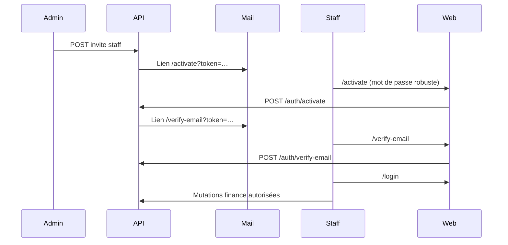

# Sécurité identité & accès — presenceFintech

Document de référence (audit SaaS + implémentation Phases A–C).  
Dépôt backend : `presence-app/backend` · Frontend : `presence-app/frontend_web`.

---

## 1. Synthèse de l'audit initial

| Domaine | État avant | État actuel |
|---------|------------|-------------|
| Vérification email staff | `isEmailConfirmed` non contrôlé sur finance | Middleware + flux verify-email |
| Reset password | Token en clair en DB | SHA-256 + expiration 1 h |
| Lockout login | `failedLoginAttempts` inutilisé | 5 échecs → lockout Redis 15 min |
| OTP verify | Pas de limite tentatives | 5 tentatives / 15 min, timing-safe |
| Token invitation staff | En clair | Haché (compat legacy) |
| KYC parent | `SKIP_KYC` risque prod | Gate forcé en production |
| Actions finance non vérifiées | RBAC seulement | `requireVerifiedStaffForMutations` |

---

## 2. Modèle de données (`User`)

Champs clés (Prisma) :

| Champ | Usage |
|-------|--------|
| `isEmailConfirmed` | Gate middleware staff |
| `emailVerifiedAt` | Horodatage confirmation |
| `phoneVerifiedAt` | Set après OTP parent réussi |
| `emailVerificationToken` | Hash SHA-256 (lien verify) |
| `emailVerificationExpiresAt` | Expiration lien verify (24 h) |
| `passwordResetToken` | Hash SHA-256 (reset MDP) |
| `tokenExpiresAt` | Expiration reset (1 h) |
| `failedLoginAttempts` | Compteur échecs login |

Migration : `20260703193000_identity_verification_timestamps`

---

## 3. Flux staff (onboarding complet)



### Étapes détaillées

1. **Invitation** — Admin invite → `StaffInvitation.token` haché en DB, token brut dans l’email.
2. **Activation** — `POST /api/v1/auth/activate` · MDP ≥ 12 car. (maj, min, chiffre, `@$!%*?&`).
3. **Vérification email** — `isEmailConfirmed=false` jusqu’au clic sur `/verify-email`.
4. **Connexion** — JWT + session ; bandeau si email non confirmé.
5. **Opérations finance** — Mutations (POST/PUT/PATCH/DELETE) bloquées si `EMAIL_NOT_VERIFIED`.

---

## 4. Backend — contrôles implémentés

### Middleware `requireVerifiedStaffForMutations`

- Fichier : `backend/src/middlewares/requireVerifiedStaff.ts`
- Rôles : `ADMIN`, `FINANCE`, `SUPER_ADMIN`
- Appliqué sur : stacks admin finance, guichet finance, super-admin finance
- **GET autorisés** (consultation) · **mutations bloquées** si `!isEmailConfirmed`

### Auth (`auth.service.ts`)

| Méthode | Sécurité |
|---------|----------|
| `login` | Lockout Redis après 5 échecs |
| `forgotPassword` / `resetPassword` | Token haché, sessions révoquées, email notification |
| `verifyEmail` | Token haché, `emailVerifiedAt` renseigné |
| `verifyOtp` | Via `OtpService.verifyCode` (rate limit + timing-safe) |
| `changePassword` | Révocation sessions + email notification |

### KYC paiements parent

- Fichier : `backend/src/utils/payment-kyc-guard.util.ts`
- `PAYMENT_ONLINE_SKIP_KYC=true` **uniquement** en `development` / `test`
- **Interdit au démarrage** en `NODE_ENV=production`

---

## 5. Frontend — pages & UX

| Route | Rôle |
|-------|------|
| `/activate?token=` | Activation staff (public) |
| `/verify-email?token=` | Confirmation email (public) |
| `/login` | Connexion (+ bandeau si `?activated=1`) |
| `/admin/profil-securite` | Profil admin |
| `/finances/profil-securite` | Profil finance |
| `/super-admin/profil-securite` | Profil super-admin |

### Composants

- `SecurityProfilePanel` — identité, statut email, changement MDP
- `EmailVerificationBanner` — bandeau mutations bloquées
- `SecurityEventListener` — toast sur `EMAIL_NOT_VERIFIED`
- `lib/auth/security-errors.ts` — messages utilisateur

### Codes d'erreur mappés

| Code | Message UX |
|------|------------|
| `EMAIL_NOT_VERIFIED` | Confirmez votre email avant opération financière |
| `ACCOUNT_LOCKED` | Compte verrouillé temporairement |
| `TOO_MANY_OTP_VERIFY_ATTEMPTS` | Trop de tentatives OTP |
| `INVALID_VERIFICATION_TOKEN` | Lien verify expiré/invalide |

---

## 6. API auth (référence rapide)

| Endpoint | Auth | Description |
|----------|------|-------------|
| `POST /auth/activate` | Public | Activation staff |
| `POST /auth/verify-email` | Public | Confirmer email |
| `POST /auth/resend-verification-email` | Bearer | Renvoyer mail verify |
| `POST /auth/change-password` | Bearer | Changer MDP (sessions révoquées) |
| `POST /auth/forgot-password` | Public | Demande reset |
| `POST /auth/reset-password` | Public | Appliquer reset |
| `GET /auth/profile` | Bearer | Profil (`isEmailConfirmed`) |

Proxy frontend : `/api/auth/*` → backend `/api/v1/auth/*`.

---

## 7. Checklist déploiement

```bash
# Backend
cd backend
npx prisma migrate deploy
npx prisma generate

# Variables prod — NE PAS définir :
# PAYMENT_ONLINE_SKIP_KYC=true

# Frontend
# NEXT_PUBLIC_APP_URL / API_URL pointant vers le backend
```

### Tests manuels recommandés

- [ ] Inviter staff → `/activate` → login → bandeau email
- [ ] Clic verify-email → bandeau disparaît → mutation finance OK
- [ ] 5 logins incorrects → `ACCOUNT_LOCKED`
- [ ] Mutation finance sans verify → toast + 403 `EMAIL_NOT_VERIFIED`
- [ ] Changement MDP depuis profil → déconnexion + email reçu

---

## 8. Pistes P2 (non implémentées)

- Renommer Prisma `passwordResetToken` → `passwordResetHash`
- MFA obligatoire pour rôles finance en production
- `phoneVerifiedAt` exposé dans profil parent mobile
- Tests E2E Playwright flux activate → verify → paiement

---

## 9. Fichiers clés

**Backend**

- `prisma/schema.prisma` — modèle `User`
- `src/middlewares/requireVerifiedStaff.ts`
- `src/services/auth.service.ts`
- `src/services/invitation.service.ts`
- `src/utils/payment-kyc-guard.util.ts`
- `src/utils/auth-security.util.ts`

**Frontend**

- `src/components/auth/security-profile-panel.tsx`
- `src/lib/auth/security-errors.ts`
- `src/lib/auth/password-policy.ts`
- `src/middleware.ts` — routes publiques auth

---

*Dernière mise à jour : juillet 2026 — Phases A, B, C + UX profil/sécurité.*
